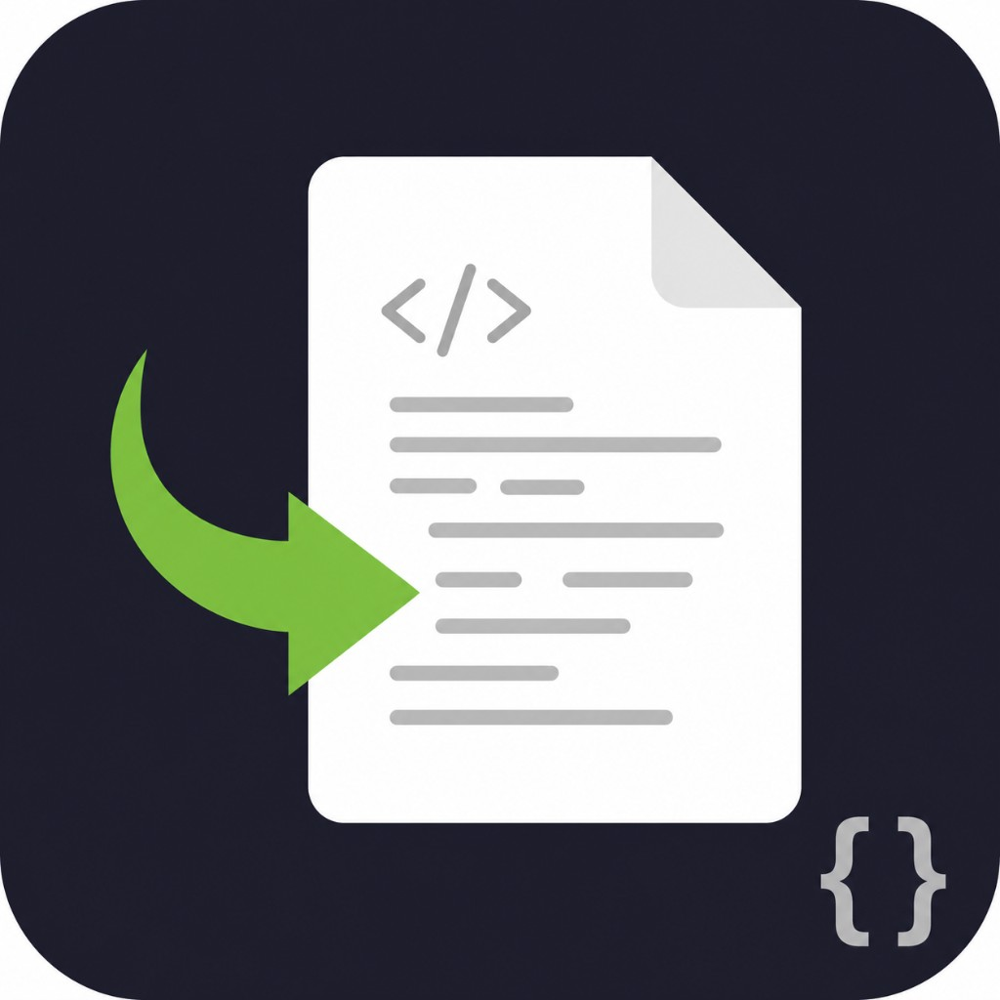

# ioBroker.autodoc

Automatically generates structured documentation (HTML, Markdown, JSON) for your ioBroker installation — on demand, on a schedule, or when the system changes.

**Version:** 0.9.48 · [Repository](https://github.com/crunchip77/ioBroker.autodoc) · [Issues](https://github.com/crunchip77/ioBroker.autodoc/issues) · 

## Contents

- [What it does](#what-it-does)
- [Installation](#installation)
- [Configuration](#configuration)
- [Copy-paste examples](#copy-paste-examples) ([Mermaid](#mermaid-cookbook-examples) · [JSON](#json-cookbook-snippets) · [CSS](#html-custom-css-examples))
- [Changelog](#changelog)
- [License](#license)

## What it does

One run scans adapters, hosts, rooms, functions, scripts, aliases, userdata, and related metadata, then writes **three profiles**:

| Profile | Audience | Focus |
| --- | --- | --- |
| **Admin** | Operators | Instances, hosts, resources, scripts, maintenance hints, diagnosis |
| **User** | Household | Rooms, devices, automations in plain language |
| **Onboarding** | Guests | Welcome, capabilities, QR / link to the latest HTML |

Files land under `/files/autodoc.<instance>/` (latest HTML plus rotated `.md` / `.html` / `.json`). Optional notifications and **opt-in AI** (separate providers) can enrich the text.

- Standalone HTML per profile (search, dark mode, responsive layout)
- Markdown + JSON export with configurable rotation
- Maintenance hints (documentation score for open checklist items; disabled instances listed as inventory, not penalized)
- Admin UI: **EN / DE / FR** complete; other locales use English until translated ([CONTRIBUTING](CONTRIBUTING.md#admin-ui-translations-i18n)). Generated wording follows **Documentation language**
- Optional AI (Ollama, Groq, Anthropic, …) — strict opt-in

## Installation

1. Open **[ioBroker Admin](https://www.iobroker.net/#en/documentation)** and install **`iobroker.autodoc`** from the adapter list.
2. Official index: **[ioBroker.repositories](https://github.com/ioBroker/ioBroker.repositories)** (**latest**).

**Requirements**

- **Node.js** ≥ 22 (`package.json` → `engines`)
- **ioBroker.js-controller** ≥ 6.0.11 (`io-package.json` → `common.dependencies`)
- **ioBroker Admin** ≥ 7.8.23 (`common.globalDependencies`) — needed for the **json** configuration UI

No other adapters are required. Optional: a **web** adapter to open generated files outside the Admin file browser. **PDF** needs optional **`puppeteer`** in the adapter directory — see [Optional PDF export](#optional-pdf-export-puppeteer).

**Guides:** [operator overview (EN)](docs/user-guide/README.md) · [German config wiki](docs/user-guide/README.de.md) (tabs, screenshots, demo scenario).

## Configuration

Configure the instance in **ioBroker Admin** (basics, manual notes, advanced, notifications, AI). Generation: manual, on startup, on a timer, or after adapter changes (debounced).

### Documentation instance overview

**Documentation language** (Basic settings) sets headings and fixed wording in **all HTML profiles** and in Markdown. Inventory-comparison and **changelog** summary lines use that language on each regenerate — older stored changelog rows are shown in the **current** export language.

**Advanced → What to include & limits → Hide “changes since last run”** removes only the yellow delta box in **Admin** HTML/Markdown. Changelog, User, and Onboarding are unchanged. The **User / Family** profile adds a short everyday sentence when at least one inventory change was found (skipped on the first run). **Onboarding** has no such notice.

| State | Role |
| --- | --- |
| `action.generate` | Run documentation |
| `action.exportPdf` | PDF from the latest HTML under `/files` (needs **`puppeteer`**; no full regenerate) |
| `info.lastGeneration` / `info.nextGeneration` | Last / next run |
| `info.htmlUrlAdmin` / `info.htmlUrlUser` / `info.htmlUrlOnboarding` | Latest HTML URLs |
| `info.templateVersion` | HTML template / renderer alignment |
| `info.forumCardPlain` | Plaintext “system card” for forums (updated on generate) |
| `documentation.exportHashes` | SHA-256 of latest MD / JSON / Admin HTML; PDF hashes merged after a PDF step |
| `documentation.markdown` / `.html` / `.json` | **Short placeholders only** — full text is under `/files/` |

### Media, Redis, and state storage (short)

- Canonical exports live under **`/files/autodoc.<instance>/`** and are **overwritten** each run.
- Full Markdown, JSON, and Admin HTML are **only** under `/files/` (`autodoc-latest.*`, profile HTML). Scripts that need the full text should read `/files/` or `info.htmlUrl*`.
- Do **not** store large photos or blobs as state values in the object database — **especially with Redis**. Use external URLs or small inline SVG.

### Public base URL

Onboarding HTML has a QR code and **Copy link**. Both point at `/files/autodoc.<instance>/autodoc-onboarding.html`, prefixed with **ioBroker base URL** (**Advanced** → *ioBroker base URL (optional)*).

- Use the URL you open in the browser (scheme, host, port if needed), **no trailing slash**. Examples: `https://home.example.com:8081`, `http://192.168.1.10:8081`.
- Empty or wrong → guests get a broken or LAN-only link. Generate again after changing it.

### Optional filesystem export (Docker / NAS)

**Filesystem export path** writes the three HTML profiles to a real directory (in addition to `/files/…`). In **Docker**, map a host folder into the container and set the **container-side** path (not the Unraid/host path). See the field help in Admin.

### Optional PDF export (Puppeteer)

**Best effort:** after a successful run, create `autodoc-admin.pdf`, `autodoc-user.pdf`, and `autodoc-onboarding.pdf` from the HTML under `/files/` (headless Chromium via optional **`puppeteer`** — same major line as **`@mermaid-js/mermaid-cli`**). Enable **Generate PDF after each documentation run** in **Advanced**, or trigger `action.exportPdf`. PDFs go under `/files/autodoc.<instance>/` and to the filesystem export path when set.

Embedded Mermaid SVG (when `mmdc` ran) prints offline; jsDelivr client Mermaid still needs internet during PDF. Without Chromium, PDF is skipped with a log line — HTML/Markdown still run.

### AI context hints (guest vs resident)

**AI context hints** go into the LLM prompt only; they are **not** printed in the documentation. For **guest onboarding**, use everyday facts — IT/project wording can leak jargon; a safety step then replaces that AI block with neutral guest text. The **resident / family** profile does not use that restriction. Configure under **KI documentation / AI documentation** after enabling a provider.

## Copy-paste examples

Field IDs and syntax: [Mermaid](#mermaid-cookbook-examples) · [JSON arrays](#json-cookbook-snippets) · [Custom CSS](#html-custom-css-examples).

<h3 id="mermaid-cookbook-examples">Mermaid cookbook examples</h3>

Turn on **Include Mermaid diagram in documentation**, then paste into **Mermaid diagram** (`manualMermaidDiagram`). Use **plain line breaks** inside the field (no HTML). Prefer **`flowchart LR`** so wide diagrams fit the HTML page; very large graphs are hard to read — split concepts across separate diagrams if needed.

**Embedded SVG:** when **`@mermaid-js/mermaid-cli`** is installed in the adapter directory and generation succeeds, diagrams become inline SVG in HTML (good for offline / PDF). If embedding fails or the CLI is missing, the export keeps a `<pre class="mermaid">` block and the browser may load Mermaid from jsDelivr — see **Optional PDF export** and **`docs/user-guide`** (“Optional Mermaid CLI”).

Minimal left-to-right overview:

```text
flowchart LR
  Internet([Internet]) --> Router[Router]
  Router --> ioB(ioBroker host)
  ioB --> Heating[Heating adapters]
  ioB --> Lights[Lights / rooms]
```

Small **subgraph** (group related nodes):

```text
flowchart LR
  subgraph LAN["Home LAN"]
    A[js-controller] --> B[javascript.0]
    A --> C[other instances]
  end
```

**Tips**

- Stick to **supported Mermaid** constructs you have seen working elsewhere; exotic directives may break `mmdc`.
- Mermaid is **opt-in**: enable **Include Mermaid diagram in documentation**, then paste source. Hide with chapter id **`mermaid`**. On **Admin** the diagram lives under **`manual`**; on **Onboarding** it is in the welcome area.

<h3 id="json-cookbook-snippets">JSON cookbook snippets</h3>

Admin stores these fields as **strings**; content must be **valid JSON** (`"` keys/strings, no trailing commas). Empty roster means defaults: use **`[]`** where you do not want to override order or hide anything.

German **scenario page** (“hide first vs reorder”, copy-paste walkthrough anchored to Step 6): **[`README.de.md` — Wiki — Step 6](https://github.com/crunchip77/ioBroker.autodoc/blob/main/docs/user-guide/README.de.md#wiki-admin-json-cookbook)** (`docs/user-guide/`).

**Allowed chapter ids** come from the adapter (`lib/docTemplateConfig.js`):

| Profile | Order fields | Hidden fields | Notes |
| --- | --- | --- | --- |
| Admin | `adminChapterOrderJson` | `adminHiddenChaptersJson` | Order default: `manual`, `system`, …, `appendices`. Owner Mermaid (opt-in) is part of **`manual`**. |
| User | `userChapterOrderJson` | `userHiddenChaptersJson` | Keys include `manual`, `ai`, `guestHelp`, `atAGlance`, `rooms`, `scripts`, `routines`, `ownerPlaybook`, `mermaid`, `adapters`, `custom`, `system`, `troubleshooting`. |
| Onboarding | `onboardingChapterOrderJson` | `onboardingHiddenChaptersJson` | Keys include `welcome`, `quickstart`, `tips`, `guestHelp`, `stats`, `ai`, `capabilities`, `mermaid`, `rooms`, `routines`, `ownerPlaybook`, `automations`, `adapters`, `custom`, `hint`, `system`, `manual`. |

**Reorder Admin** — put system overview directly after manual context:

```json
["manual", "system", "adapters", "rooms", "automationOverview", "scripts", "schedule", "userdata", "aliases", "maintenance", "diagnosis", "troubleshooting", "custom", "changelog", "appendices"]
```

**Hide** Admin changelog and appendices:

```json
["changelog", "appendices"]
```

**Hide User scripts chapter:**

```json
["scripts"]
```

**Reorder User** — bring **`system`** up after rooms (full key list, same ids as default order otherwise):

```json
["manual", "guestHelp", "ai", "atAGlance", "rooms", "system", "scripts", "routines", "ownerPlaybook", "mermaid", "adapters", "custom", "troubleshooting"]
```

**Custom Markdown chapters** (`customDocSectionsJson`) — array of objects with **`title`**, **`body`** (or **`bodyMarkdown`**), optional **`profiles`** (`"admin"` | `"user"` | `"onboarding"`). Omit **`profiles`** to show in **all** profiles.

```json
[
  {
    "title": "Emergency contacts",
    "body": "## Numbers\n- **Repair:** …\n- **Utility:** …",
    "profiles": ["user", "onboarding"]
  },
  {
    "title": "Operator notes",
    "body": "## Rack layout\nShort **Markdown** only; keep secrets out.",
    "profiles": ["admin"]
  }
]
```

Max **12** sections; very long bodies are truncated at generation time.

<h3 id="html-custom-css-examples">HTML custom CSS examples</h3>

Under **Admin → HTML export & extra sections**, **Font stack** (`htmlFontStack`) and **Extra CSS** (`htmlExtraCss`) tweak only the **exported HTML** (not Markdown). The renderer wraps pages in `lib/htmlRenderer.js` (`wrapPage`): sidebar links live under **`nav ul li a`**, layout uses **`#layout`**, **`nav`**, and **`main`** — inspect generated HTML if you need a selector.

**Font stack:** one CSS `font-family` list (risky characters `< > { }` are stripped). Example paste:

```css
"Source Serif 4", Georgia, serif
```

**Extra CSS:** append short rules after the built-in stylesheet. Prefer **existing palette tokens** (`var(--link)`, `var(--nav-bg)`, `var(--border)`, `var(--surface)`, … from the `:root` / `body.dark` blocks); **`htmlThemePreset`** swaps those via `html.autodoc-preset-*` classes — there is no separate `--accent` token on `:root` (some components use `var(--accent, #0066cc)` as a **local** fallback only).

Starter snippet you can paste into **Extra CSS**:

```css
nav { width: 260px; }
nav ul li a:hover { opacity: 0.92; }
h2 { border-bottom-color: var(--link); }
```

**Contributing:** see [`CONTRIBUTING.md`](CONTRIBUTING.md).

## Changelog

**Admin `common.news`** in `io-package.json` lists only versions **published on npm** (Adapter Checker **E2004**). The detailed sections below are the **user-facing** changelog (Git-era releases plus npm); older entries are in [`CHANGELOG_OLD.md`](CHANGELOG_OLD.md).

### **WORK IN PROGRESS**

- **Mermaid:** removed auto host topology (`autoMermaidHostGraph`). Manual diagram is **opt-in** (`enableManualMermaid`); existing instances that already have diagram text keep it until they turn the option off.

### 0.9.48 (2026-09-22)

- **Admin — Automation overview:** New **Automatisierung im Überblick** chapter collects time-based JavaScript CRON, ioBroker schedule objects, adapter schedule/restart CRON, and a transparent “what AutoDoc cannot list as a schedule” summary for Blockly/subscribe/rule-engine limits.
- **User / Onboarding — automation clarity:** Family docs now keep automation summaries readable even when Blockly/scripts have no `common.desc`; Quick Start counts active JavaScript automations without exposing technical script names to guests.
- **Rooms and functions:** User/Admin exports resolve room/function members through the ioBroker object hierarchy (State → Channel → Device), deduplicate common POWER/state duplicates, show better device names, and list **functions** with per-function devices like the room device hierarchy.
- **HTML UX polish:** Connected systems, host topology, manual Mermaid diagrams, and function sections are collapsible where they would otherwise dominate the page; disclosure arrows use a more consistent muted style. Room notes now live in expanded room details instead of the compact Admin room table.
- **Mermaid / offline SVG:** `@mermaid-js/mermaid-cli` bumped to 11.16.0; logs now point more clearly at missing Chromium libraries, and `scripts/install-chromium-deps-linux.sh` documents Linux/buanet package hints. Renderer marker: `2026.09.22.9`.

### 0.9.47 (2026-09-20)

- **Repository checker (#60):** Maintainer contact email (E4052); README **`## License`** links to [`LICENSE`](./LICENSE) (E6034)
- **CI:** Node.js **26.x** added to adapter test matrix (W3026)
- **Release / provenance:** npm publish via GitHub Actions **`deploy`** job (Trusted Publishing) — fixes missing attestations from workstation **0.9.46** (E2008)
- **Dependencies:** `@tsconfig/node22`, `@iobroker/adapter-core` bumps (Dependabot)
- **Docs:** Maintainer notes for latest re-listing, stable deferred (#54), platform reconnaissance
- **Runtime:** no adapter behavior changes

### 0.9.46 (2026-06-28)

- (mcm1957) `info.summary` state now outputs English text by default
- (mcm1957) Periodic documentation generation switched from `setInterval` to `setTimeout`-at-end — prevents overlapping runs
- (mcm1957) `autoGenerateInterval` code-level minimum clamp of 0.1 h with warning log
- (mcm1957) README: GitHub install instruction removed (E6013)
- (fix) `common.news` 0.9.37 / 0.9.38 / 0.9.44 translated into es, it, nl, pl, pt, ru, uk, zh-cn (E1144)
- (fix) `admin` minimum version bumped to `>=7.8.23`

### 0.9.45 (2026-06-18)

- **ioBroker conformance — object structure:** Added channel parent objects (`action`, `documentation`, `info`, `versioning`) to `instanceObjects` in `io-package.json` — required by ioBroker object checker (E3009) for **ioBroker.repositories** review.
- **ioBroker conformance — timers:** `adapter.delay()` (ioBroker base class) for AI retry delays; `window.setTimeout` / `globalThis.setTimeout` in browser-side and utility code — no bare `setTimeout` in adapter runtime (E5005/W5004 fixes).
- **i18n:** All 10 supported languages translated via `@iobroker/adapter-dev` (Google Translate); `de` and `fr` remain manually maintained. Missing keys synced across all locales.
- **Dependencies:** `@iobroker/adapter-core` → 3.4.1, `cytoscape` → 3.34.0.

### 0.9.44 (2026-05-14)

- **Chapter JSON & logs:** Each documentation run evaluates Admin/User/Onboarding chapter order and hide JSON. **English** adapter **`warn`** lines report invalid JSON shape, **unknown** chapter ids, and **duplicate** ids, with a pointer to the **[German user guide — JSON cookbook](https://github.com/crunchip77/ioBroker.autodoc/blob/main/docs/user-guide/README.de.md#wiki-admin-json-cookbook)**. Identical warning **lines** are **deduplicated** per adapter **log** reference (process lifetime). Values read only from **legacy** native keys are labeled **`…Json via native …`** in the log. **`lib/chapterConfigWarnings.js`**; wired from **`DocumentModel.buildDocumentModel`**. **`EXTRA_HIDDEN_CHAPTER_IDS`** exported from **`docTemplateConfig`** for hide-list validation.
- **Admin i18n:** Extended **`?`** help for the six chapter order/hide JSON fields (log + GitHub links under **Which chapters to show (per profile)**) — **DE/FR** translated, **EN** + other locales as fallbacks.
- **Quick Start (5.x.2):** Room highlight **`HIGHLIGHT_CATEGORY_RANK`** extended (**`leak`**, **`co2`**, **`valve`**, **`weather`**, **`sensor`**, …); function areas with equal **member count** tie-break by **name**.
- **HTML template:** **`RENDERER_VERSION`** in **`lib/htmlRenderer.js`** bumped so instances that skip “generate on start” still **regenerate once** after the adapter update (**`info.templateVersion`** vs renderer marker).
- **Docs maintainer:** **`docs/user-guide/assets/SCREENSHOTS.md`** notes that tooltip-only changes often need **no** new PNG.

### 0.9.43 (2026-05-13)

- **Admin / Adapter Checker:** **`common.news`** lists only semver versions that exist as tarballs on **npm** (ioBroker Adapter Checker **E2004**). Removed **`news`** keys **0.9.39**, **0.9.40**, and **0.9.41** — those bumps never shipped to the registry between **0.9.38** and **0.9.42**. Full narrative for **0.9.41–0.9.39** is kept in **`CHANGELOG_OLD.md`** (README changelog window matches the **`common.news`** version set).
- **`common.news` copy:** **0.9.42** admin news now compares against **0.9.38** (last npm release before **0.9.42**).
- **Runtime:** unchanged.

### 0.9.42 (2026-05-13)

- **npm / process:** Patch **0.9.42** — **no functional change** vs **0.9.38** (previous tarball on npm before **0.9.42**); `package.json` / `io-package.json` / README **`Version:`** aligned for npm publish only (release-script housekeeping).

[Older changelogs can be found there](CHANGELOG_OLD.md)

<!-- Maintainer: Admin staticLinks — under chapter visibility: English README `#json-cookbook-snippets`, Wiki DE `#wiki-admin-json-cookbook`. Schnellzugriff in README.de; SCREENSHOTS table for PNG drift; Sync jsonConfig/i18n if URLs change. -->

## License

MIT License

Copyright (c) 2026 crunchip77 <crunchip77@gmail.com>

The complete license text is in the [LICENSE](./LICENSE) file.
